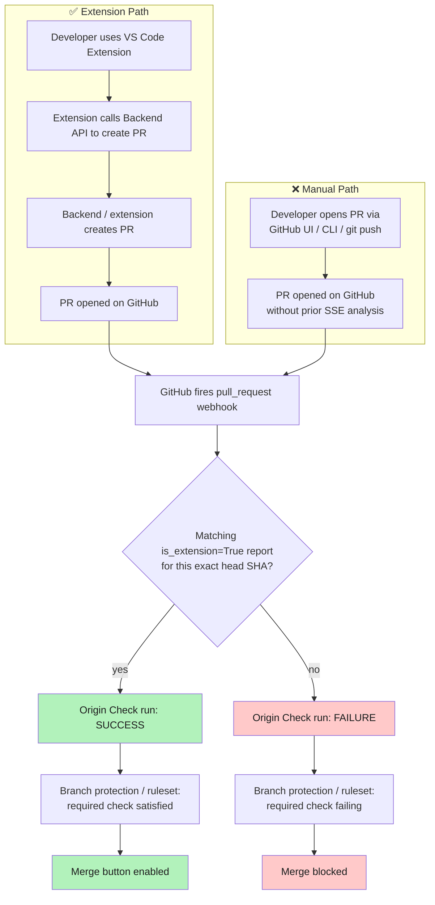
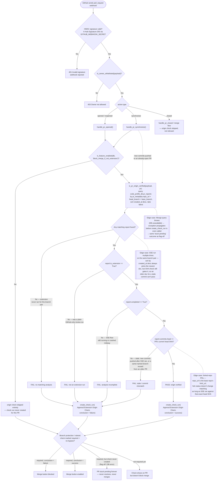
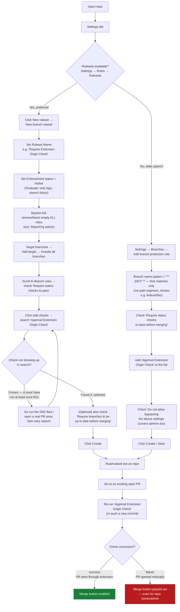

# Blocking PR Merges Unless Raised via the AppMod VS Code Extension

**Status: Core origin check implemented and verified working. Ruleset automation designed, not yet implemented.**

## 1. Problem Statement

We want to prevent a PR from being merged unless its code was reviewed through the AppMod VS Code Extension's flow *before* the PR was opened on GitHub. A PR opened directly on github.com (or via `gh cli`, or any other tool) should be blocked from merging.

GitHub has no native concept of "which tool opened this PR" — the only lever available is a **required status check** in branch protection. Everything below is about producing a trustworthy check result and making sure it actually gates the merge button.

## 2. The Signal We Use

The VS Code extension calls `POST /api/pr_reviewer/pr-reviewer/open` (an SSE endpoint) **before** the PR exists on GitHub. That flow (`handle_pr_opened_sse` in `App/pr_reviewer/github_app/webhook_handlers.py`) already:

1. Fetches the diff between head and base branch directly (`github_manager.get_pre_pr_files(...)` in `App/pr_reviewer/utils/git_utils.py`) — works without a PR existing yet.
2. Runs the full AI review pipeline.
3. Writes a Mongo document to `code_profile_db.pr_reports` (via `PRReport.initialize_db()` in `App/pr_reviewer/pipeline/core.py`, class `PRReport`, ~line 5104) containing:
   - `pr_metadata.repo_url`, `pr_metadata.head_branch`, `pr_metadata.base_branch`
   - `commits.head` — the **exact commit SHA** that was analyzed
   - `is_extension = True`
   - `completed = True` once the pipeline finishes

When the real `pull_request` webhook later arrives, we look up this document by repo/branch names, and require:

- a matching document exists,
- `is_extension == True` (not a plain GitHub-native review),
- `completed == True` (the SSE run actually finished),
- `commits.head` equals **the PR's current head SHA**.

Matching on the **exact SHA** (not just branch names) is what makes this trustworthy: an attacker can't just open a manually-created PR on a similarly-named branch and inherit a pass — they'd need the exact commit content to have gone through `/pr-reviewer/open` first.

## 3. Architecture Diagram



## 4. Detailed Technical Flow & Edge Cases

This breaks the single boolean check into its four component conditions (matching the actual code), and calls out the operational failure modes worth knowing about.



### Edge cases this covers
| # | Scenario | Result |
|---|---|---|
| 1 | Extension never ran for this branch pair | FAIL — no matching report |
| 2 | A prior review exists but was a plain GitHub-native run (`is_extension=False`) | FAIL — not an extension run |
| 3 | SSE flow started but crashed/never finished | FAIL — analysis incomplete |
| 4 | New commits pushed after the SSE run, or branch name reused from an older PR | FAIL — stale / commit mismatch |
| 5 | Exact match on all four conditions | PASS |
| 6 | New commits pushed to an already-open PR (`synchronize`) | Re-evaluated fresh — can flip either direction |
| 7 | PR closed then reopened | Re-evaluated fresh via `handle_pr_opened` |
| 8 | Forked-repo PRs | Still covered — matching is on the base repo's `repo_url`, unaffected by fork status |
| 9 | Mongo/DB unavailable when the webhook fires | Exception before check-run creation → check never appears → PR stuck pending indefinitely if the check is required (fail-closed, but can strand PRs — worth a dashboard/alert) |
| 10 | Feature flag `block_merge_if_not_extension` turned off | Check skipped entirely → same "stuck pending" risk if the required-check setting wasn't also removed |

## 5. Implementation Part 1 — The Origin Check (done, verified working)

### `App/pr_reviewer/enums.py` — `CheckRunConfig`
```python
@staticmethod
def _ORIGIN_CHECK_PASSED():
    return {
        "name": "Appmod Extension Origin Check",
        "status": "completed",
        "conclusion": "success",
        "title": "PR Origin Verified ✅",
        "summary": "This PR's code was reviewed via the AppMod VS Code Extension before it was opened.",
        "text": "Origin check passed."
    }

@staticmethod
def _ORIGIN_CHECK_FAILED():
    return {
        "name": "Appmod Extension Origin Check",
        "status": "completed",
        "conclusion": "failure",
        "title": "PR Not Raised via Extension ❌",
        "summary": "This PR was not opened through the AppMod VS Code Extension. Please use the extension to raise PRs.",
        "text": "No matching extension-reviewed analysis was found for this exact commit."
    }
```

### `App/pr_reviewer/github_app/webhook_handlers.py`
```python
def is_pr_origin_verified(payload, pr):
    origin_report = code_profile_db.pr_reports.find_one(
        {
            "pr_metadata.repo_url": payload['repository']['html_url'],
            "pr_metadata.head_branch": pr['head']['ref'],
            "pr_metadata.base_branch": pr['base']['ref'],
        },
        sort=[("created_at", -1)],
        projection={"is_extension": 1, "completed": 1, "commits": 1},
        hint=config.PREVIOUS_REPORT_INDEX_NAME,
    ) or {}

    current_head_sha = pr.get('head', {}).get('sha')
    return (
        bool(origin_report)
        and origin_report.get("is_extension", False)
        and origin_report.get("completed", False)
        and origin_report.get("commits", {}).get("head") == current_head_sha
    )
```

Called in **`handle_pr_opened`** (right after the existing `INITIAL_PR_APPMOD_QUALITY_CHECK` check-run creation) and in **`handle_pr_synchronize`** (right after `INITIAL_PR_SYNC_APPMOD_QUALITY_CHECK`), reusing the already-constructed `github_manager`:
```python
origin_config = CheckRunConfig._ORIGIN_CHECK_PASSED() if is_pr_origin_verified(payload, pr) else CheckRunConfig._ORIGIN_CHECK_FAILED()
github_manager.create_check_run(**origin_config, pat_token=token)
```
Not needed in `handle_pr_closed` — irrelevant once merged/closed.

**Optional feature flag**: wrap both call sites in `if is_feature_enabled(code_profile_db, "block_merge_if_not_extension"):` (helper already exists at `App/pr_reviewer/utils/misc_utils.py:7`) so this can be toggled off without a deploy.

### Local test loop used to verify this
1. Run the Flask app locally with the normal env vars (Mongo, GitHub App ID/key/webhook secret).
2. Push a branch to a real repo with the GitHub App installed, call `/pr-reviewer/open` for it (writes the `is_extension=True` Mongo doc).
3. Tunnel local Flask with `ngrok http <port>`, point the App's webhook URL at `<tunnel>/api/pr_reviewer/pr-reviewer/webhook`.
4. Open the real PR → check shows `success`.
5. Control case: open a PR on a different branch *without* calling `/pr-reviewer/open` first → check shows `failure`. **Confirmed working in testing.**

## 6. Implementation Part 2 — Making the Check Actually Block Merge

A failing check does **nothing** on its own — GitHub only blocks merge for checks marked **required**, and even then, admins can bypass unless explicitly told not to.

### Recommended: Repository/Organization Rulesets (not classic branch protection)
Rulesets support targeting **all branches** in one click/call and give fine-grained bypass control.

**Manual setup (per repo), one time:**
1. Repo → **Settings → Rules → Rulesets → New ruleset → New branch ruleset**.
2. Name it, e.g. `Require Extension Origin Check`.
3. **Enforcement status = Active** ("Evaluate" only logs, doesn't block).
4. **Bypass list = empty** — removes admin/owner override too. This is the step that's easy to miss and causes "the check failed but I could still merge."
5. **Target branches** → either **Add target → Include all branches** (simplest), or **Add target → Include by pattern** and enter just the branch(es) PRs actually merge into (e.g. `main`, `dev`) — narrower and usually sufficient, since protection on a feature/topic branch has no effect (nobody merges "into" those).
6. **Branch rules → Require status checks to pass** → search and add `Appmod Extension Origin Check` (only selectable after it's run at least once on the repo).
7. Create.

**Fallback if Rulesets aren't available**: classic **Settings → Branches → Add rule**, pattern `**` (not `*` — that only matches one path segment), check "Require status checks to pass before merging" + add the check, and check **"Do not allow bypassing the above settings"**.

## 7. Implementation Part 3 — Automating Ruleset Creation via the GitHub App (designed, not yet applied)

Doing this by hand doesn't scale. Two options:

- **Org-wide ruleset** (`POST /orgs/{org}/rulesets` with `repository_name.include: ["*"]`) — one call covers every repo in the org. Downside: it also applies to repos the App isn't installed on, so the required check never gets created there and those PRs stay permanently blocked with no way to pass.
- **Per-repo ruleset, provisioned exactly when the App is installed on that repo** (`POST /repos/{owner}/{repo}/rulesets`) — only touches repos where the check will actually run, and only needs repo-level `administration: write` (an easier permission ask than org-wide admin). **This is the recommended approach.**

### `App/pr_reviewer/enums.py` — repo-level ruleset payload
```python
class RulesetConfig:
    """Payload builder for the 'require extension origin check' ruleset."""

    RULESET_NAME = "Require Extension Origin Check"

    # Only branches PRs actually get merged into need this — protecting every
    # branch is unnecessary since nobody merges "into" a feature/topic branch.
    # ~DEFAULT_BRANCH avoids hardcoding main vs master vs dev per repo.
    DEFAULT_PROTECTED_BRANCH_PATTERNS = ["~DEFAULT_BRANCH"]

    @staticmethod
    def _ORIGIN_CHECK_REPO_RULESET(app_id, branch_patterns=None):
        branch_patterns = branch_patterns or RulesetConfig.DEFAULT_PROTECTED_BRANCH_PATTERNS
        return {
            "name": RulesetConfig.RULESET_NAME,
            "target": "branch",
            "enforcement": "active",
            "bypass_actors": [],
            "conditions": {
                "ref_name": {"include": branch_patterns, "exclude": []}
            },
            "rules": [
                {
                    "type": "required_status_checks",
                    "parameters": {
                        "required_status_checks": [
                            {
                                "context": "Appmod Extension Origin Check",
                                "integration_id": int(app_id)
                            }
                        ],
                        "strict_required_status_checks_policy": False
                    }
                }
            ]
        }
```
No `repository_name` condition needed — the URL already scopes it to one repo. `integration_id` pins the required check to *this specific GitHub App* — nobody can satisfy the requirement with an unrelated Action or App reporting a same-named check.

**Scoping to specific branches instead of all branches:**
- `~ALL` (used earlier in this doc) matches every branch in the repo — more than necessary, since only the branch(es) PRs merge *into* matter.
- `~DEFAULT_BRANCH` (the new default above) always resolves to whatever that specific repo's default branch is, so it works across repos regardless of whether they call it `main`, `master`, or something else — no per-repo config needed.
- To cover more than just the default branch (e.g. this repo also merges into `dev`), pass explicit patterns instead: `branch_patterns=["~DEFAULT_BRANCH", "refs/heads/dev"]`, or a glob like `"refs/heads/release/*"`. These don't need to match a branch that exists yet — they're just patterns evaluated at merge time.
- If different repos need different branch lists, that list would need to come from somewhere per-repo (a config collection, an env var, etc.) rather than being one constant for every install — not built yet, call `_provision_rulesets` with an explicit `branch_patterns` argument per repo if/when that's needed.

### `App/pr_reviewer/github_app/auth.py` — new methods on `GitHubApp`
```python
def create_repo_ruleset(self, installation_id, owner, repo, ruleset_payload):
    """Create the repo-level branch protection ruleset using the installation token.
    Returns a 422 if a ruleset with this name already exists on the repo —
    expected on webhook redelivery, not treated as an error here.
    """
    token = self.get_installation_token(installation_id)
    url = f"https://api.github.com/repos/{owner}/{repo}/rulesets"
    response = self.make_api_request(token, 'POST', url, ruleset_payload)

    if response.status_code in (200, 201):
        logger.info(f"✅ Created ruleset '{ruleset_payload.get('name')}' for {owner}/{repo}")
    elif response.status_code == 422:
        logger.info(f"Ruleset '{ruleset_payload.get('name')}' already exists for {owner}/{repo}, skipping")
    else:
        logger.error(f"❌ Failed to create ruleset for {owner}/{repo}: {response.status_code} {response.text}")

    return response

def list_installation_repositories(self, installation_id):
    """Enumerate repos this installation actually has access to. Needed because the
    'installation' webhook payload doesn't reliably list every repo for 'All repositories' installs.
    """
    token = self.get_installation_token(installation_id)
    repos = []
    url = "https://api.github.com/installation/repositories?per_page=100"
    while url:
        response = self.make_api_request(token, 'GET', url)
        if response.status_code != 200:
            logger.error(f"Failed to list installation repositories: {response.status_code} {response.text}")
            break
        repos.extend(response.json().get('repositories', []))
        url = response.links.get('next', {}).get('url')
    return repos
```

### `App/pr_reviewer/github_app/webhook_handlers.py` — auto-provision on install
```python
from pr_reviewer.enums import CheckRunConfig, RulesetConfig
from pr_reviewer.config.github_config import GitHubAppConfig

def _provision_rulesets(github_app, installation_id, repos):
    ruleset_payload = RulesetConfig._ORIGIN_CHECK_REPO_RULESET(GitHubAppConfig.GITHUB_APP_ID)
    for repo in repos:
        owner, name = repo['full_name'].split('/', 1)
        try:
            github_app.create_repo_ruleset(installation_id, owner, name, ruleset_payload)
        except Exception as e:
            logger.error(f"Failed to provision ruleset for {repo['full_name']}: {e}", exc_info=True)

def handle_installation_event(payload):
    """Fresh App install (single repo, selected repos, or all repos) -> provision every accessible repo."""
    action = payload.get('action')
    if action != 'created':
        return jsonify({'message': f'Installation action {action} ignored'}), 200

    installation_id = payload.get('installation', {}).get('id')
    github_app = GitHubApp()
    repos = github_app.list_installation_repositories(installation_id)
    _provision_rulesets(github_app, installation_id, repos)

    return jsonify({'message': f'Installation event handled, provisioned {len(repos)} repo(s)'}), 200

def handle_installation_repositories_event(payload):
    """New repos added to an already-existing installation -> provision just those repos."""
    action = payload.get('action')
    if action != 'added':
        return jsonify({'message': f'Installation_repositories action {action} ignored'}), 200

    installation_id = payload.get('installation', {}).get('id')
    repos_added = payload.get('repositories_added', [])
    github_app = GitHubApp()
    _provision_rulesets(github_app, installation_id, repos_added)

    return jsonify({'message': f'Provisioned ruleset for {len(repos_added)} newly added repo(s)'}), 200
```

### `App/pr_reviewer/github_app/app.py` — route both events
```python
from pr_reviewer.github_app.webhook_handlers import (
    verify_webhook_signature,
    handle_pull_request_event,
    handle_pull_request_review_event,
    handle_pull_request_review_comment_event,
    handle_installation_event,               # add this
    handle_installation_repositories_event,  # add this
)
...
    elif event_type == 'installation':
        return handle_installation_event(payload)
    elif event_type == 'installation_repositories':
        return handle_installation_repositories_event(payload)
```

### One-off backfill for repos already installed before this existed
`scripts/backfill_repo_rulesets.py` (standalone, not a Flask route):
```python
import sys, os, requests
sys.path.insert(0, os.path.join(os.path.dirname(__file__), '..', 'App'))

from pr_reviewer.github_app.auth import GitHubApp
from pr_reviewer.enums import RulesetConfig
from pr_reviewer.config.github_config import GitHubAppConfig

def backfill():
    github_app = GitHubApp()
    jwt_token = github_app.generate_jwt()
    headers = {'Authorization': f'Bearer {jwt_token}', 'Accept': 'application/vnd.github.v3+json'}

    response = requests.get('https://api.github.com/app/installations', headers=headers)
    response.raise_for_status()

    ruleset_payload = RulesetConfig._ORIGIN_CHECK_REPO_RULESET(GitHubAppConfig.GITHUB_APP_ID)

    for installation in response.json():
        installation_id = installation['id']
        repos = github_app.list_installation_repositories(installation_id)
        for repo in repos:
            owner, name = repo['full_name'].split('/', 1)
            print(f"Provisioning ruleset for {repo['full_name']}...")
            resp = github_app.create_repo_ruleset(installation_id, owner, name, ruleset_payload)
            print(f"  -> {resp.status_code}")

if __name__ == '__main__':
    backfill()
```

### Prerequisites this needs (manual, one-time, can't be automated)
1. **Permission grant**: add repository-level `administration: write` to the App's permission manifest (GitHub App settings → Permissions). Every org/repo that already has the App installed will get a prompt to approve the escalation.
2. **Webhook subscription**: in the App's settings → "Subscribe to events", enable both **Installation** and **Installation repositories**. Without these, neither webhook is ever delivered, regardless of code.

### What happens to which repos

| Repo situation | What actually happens | Manual step needed? |
|---|---|---|
| **App installed fresh** on a repo/org *after* this code ships | GitHub fires `installation` (`action: created`). `handle_installation_event` enumerates every accessible repo and creates the ruleset on each. | None — fully automatic. |
| **App already installed on some repos, new repo added** to that installation *after* this code ships (e.g. moving from "selected repos" to adding one more) | GitHub fires `installation_repositories` (`action: added`) with just the new repo(s) in `repositories_added`. `handle_installation_repositories_event` provisions only those. | None — fully automatic. |
| **App was already installed on a repo *before* this code shipped** | Nothing — GitHub only fires `installation`/`installation_repositories` on the actual install/add action, never retroactively. These repos silently get no ruleset unless someone runs the backfill. | Yes — run `scripts/backfill_repo_rulesets.py` once. It walks every existing installation via `GET /app/installations` and applies the same ruleset to every repo it finds, so after one run these repos are in the same state as a fresh install. |

**Nuance for the backfill case**: the ruleset API lets you require a check *by name* even if it has never run on that repo yet — unlike the manual UI flow, which only lets you pick a check from a list of ones that have already appeared. That means backfilling a repo takes effect immediately, but any **PR that was already open on that repo at backfill time** won't have the check evaluated retroactively — the ruleset only reacts to future `pull_request` webhook events. Those PRs will show the check as required-but-missing ("stuck pending") until a new commit triggers a `synchronize` event (or someone manually re-triggers review), which is when the check actually gets created and evaluated for the first time. Worth a heads-up to whoever owns those repos before flipping this on.

### New GitHub App permissions this requires

The App today (inferred from what the existing code already calls) needs roughly:
- **Checks: Read & write** — to create/update the "Appmod Code Scan" / "Appmod Quality Check" / origin check check-runs.
- **Pull requests: Read & write** — to read PR/commit/file data and post review comments.
- **Contents: Read** — to fetch diffs/files for the review pipeline.
- **Metadata: Read-only** — mandatory baseline for every GitHub App, granted automatically.

Automating ruleset creation adds exactly one new permission:
- **Repository → Administration: Read & write** — required to call the Rulesets API (`POST /repos/{owner}/{repo}/rulesets`). This is a broad permission: it also covers branch protection, webhooks, deploy keys, and other repo-settings-level actions, not just rulesets — GitHub doesn't offer a narrower scope just for rulesets.

No org-level permission is needed with the per-repo approach (that's one of its advantages over the org-wide ruleset alternative, which would need organization-level `administration: write` instead).

Event subscriptions (**Installation**, **Installation repositories**) are separate from resource permissions — every GitHub App can subscribe to these regardless of which permissions it holds, since they describe the App's own install lifecycle rather than access to repo content.

Practically: this permission change must be added in the App's manifest, and **every org/repo that already has the App installed will see a "this integration requires additional permissions" prompt** that an admin has to explicitly approve before the App can act on that repo again (existing functionality keeps working under the old permissions in the meantime — it degrades gracefully, but the new automation simply won't run for un-approved installs).

### Plan / repo-visibility requirements (public vs. private)

Rulesets are plan-gated by GitHub — identically to classic branch protection — regardless of whether they're created through the UI or through this App's API calls:

| Repo visibility | Plan requirement |
|---|---|
| **Public repo** | Works on **GitHub Free** — no upgrade needed, any plan. |
| **Private/internal repo, owned by a personal account** | Needs **GitHub Pro** (or higher) on that account. |
| **Private/internal repo, owned by an organization** | Needs **GitHub Team or GitHub Enterprise Cloud/Server** — a Free-plan org does **not** get this on private repos. |

Practical implications for `handle_installation_event` / `handle_installation_repositories_event`:
- These handlers fire for **every** repo the App gets installed on, including customer repos you don't control the plan for. A private repo under a Free personal account or Free-plan org will fail the `create_repo_ruleset` call.
- GitHub returns a non-2xx (typically 403/422) with a message pointing at the plan limitation — but the current code (`create_repo_ruleset` in `auth.py`) only distinguishes `200/201` (success) from `422` (already exists) and logs everything else as one generic `❌ Failed to create ruleset for {owner}/{repo}` error. A real plan-limitation failure and an actual bug look identical in the logs today.
- Net effect: a customer on a Free plan with private repos installs the App, gets no error surfaced to them, and silently ends up with **no merge protection at all** — the origin check still runs and reports success/failure on PRs, it's just never enforced.

**Not yet implemented, but worth adding**: have `create_repo_ruleset` inspect the response body for the plan-limitation message and return/log a distinct status (e.g. `"plan_upgrade_required"`) instead of a generic failure, so this case can be surfaced to the customer or tracked separately from real errors, rather than disappearing into backend logs.

### Disadvantages of automating this vs. manually adding the rules

Manually clicking through Settings → Rules for each repo is slower, but it comes with guardrails that automation gives up:

1. **Permission trust cost.** `Administration: write` is one of the more sensitive GitHub App permissions — it's a much bigger ask than `Checks`/`Pull requests`, and security-conscious orgs may slow-walk approving it or reject it outright, which manual setup never requires at all (a human with existing repo access just clicks the UI).
2. **No per-repo judgment call.** A human doing this manually can decide "this particular repo shouldn't have this enforced yet" (legacy repo, team not onboarded to the extension, etc.). Automatic provisioning on install applies the same rule everywhere uniformly, with no opt-out — the moment the App is installed, PRs can start getting blocked, possibly surprising a team that didn't expect it.
3. **Bigger blast radius for bugs.** A mistake in the ruleset payload (wrong `integration_id`, wrong branch pattern, etc.) instantly propagates to every repo the App is installed on or gets installed on next, rather than being caught/limited to whichever repos an admin happened to click through by hand.
4. **Silent, surprising enforcement.** Repo admins may not remember or even know this ruleset was added, since it happens automatically on install rather than through a deliberate action they took — this tends to generate confused "why can't I merge my own PR" complaints, especially combined with the empty bypass list.
5. **Orphaned rulesets on uninstall.** GitHub does not remove a ruleset when the App is uninstalled or loses access to a repo — the created rule stays behind. If cleanup isn't separately built (listening for `installation.deleted` / `installation_repositories.removed` and deleting the ruleset), a repo that uninstalls the App is left with a required check that can never pass again, since nothing is left to create it — effectively unmergeable until someone manually removes the rule. Manual setup has this same risk in theory, but it's far less likely to be forgotten about since a human consciously created it.
6. **No staged rollout.** Manual, repo-by-repo setup naturally acts as a canary — you can watch one repo before doing the next. Automatic provisioning enforces on every future install immediately and uniformly from day one, which is a lot of exposure for a feature the status line at the top of this doc still calls a POC.
7. **API coupling.** Rulesets is a comparatively newer GitHub API and has changed shape before. An automated integration is coupled to that schema staying stable; a manually-configured rule made through the UI is insulated from that even if the underlying API evolves.

Given the doc currently reflects a POC, it's worth validating on a handful of pilot repos manually (Part 2/8 above) before requesting the `Administration` permission broadly and turning on the automated path in Part 3.

## 8. Branch Protection Setup — Step by Step (for repos not using the automated ruleset yet)



## 9. Summary / Current Status

| Piece | Status |
|---|---|
| Origin check logic (`is_pr_origin_verified`, new check-run configs) | ✅ Implemented and confirmed working — check correctly shows `success`/`failure` |
| Branch protection ruleset on test repo (manual) | ✅ Confirmed — merge button now respects the check once bypass list is emptied |
| Per-repo ruleset automation via GitHub App (`installation` / `installation_repositories`) | 🔲 Designed, not yet implemented — needs repo-level `administration` permission grant + webhook subscription first |
| Feature flag for safe rollout | 🔲 Optional, not yet added |
| Backfill script for existing installs | 🔲 Written, not yet run anywhere |
