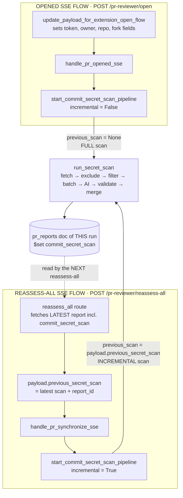
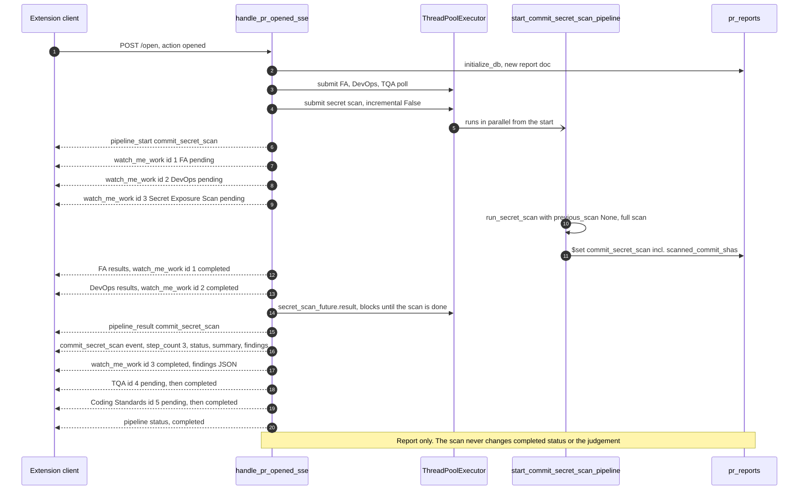
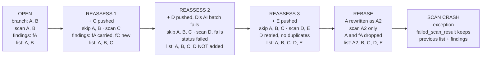

## 1. Overview: both flows share one scanner

## 2. Opened SSE flow: when the scan runs and the order of its events

## 3. Reassess-all SSE flow: route, handler, sync pipeline and fallback

```mermaid
flowchart TB
    A["POST /pr-reviewer/reassess-all<br/>headers X-Github-Token, Guidelines-Token<br/>body base_branch, head_branch, head_repo_url,<br/>base_repo_url, is_forked_repo, session_id ..."]
    A --> V1{"required params present?"}
    V1 -->|no| E400a["SSE error 400"]
    V1 -->|yes| V2{"session already running?"}
    V2 -->|yes| E409a["SSE error 409"]
    V2 -->|no| L["build pr_url, fork aware<br/>take lock sync_validation_lock:pr_url"]
    L -->|lock held| E409b["SSE error 409"]
    L --> HEAD["current_head_sha = get_latest_commit_sha"]
    HEAD --> GET["get_latest_report_from_pr_url with projection:<br/>_id, commits, completed, has_error,<br/>commit_secret_scan.scanned_commit_shas,<br/>.commits.commit_sha, .commits.batch_ids,<br/>.batches.batch_id, .batches.status,<br/>.skipped_commits, .findings"]
    GET --> V3{"report exists, completed,<br/>no error, base/head known,<br/>head changed?"}
    V3 -->|no| E4xx["SSE error 400 / 404<br/>lock released"]
    V3 -->|yes| P["update_payload_for_extension_sync_flow"]
    P --> PS{"latest report has commit_secret_scan?"}
    PS -->|yes| PS1["payload.previous_secret_scan =<br/>scan + report_id"]
    PS -->|no| PS2["payload.previous_secret_scan = empty<br/>→ full scan"]
    PS1 --> RUN
    PS2 --> RUN
    RUN["start heartbeat + pipeline_runner threads<br/>stream events via Redis, resumable through /open"]

    RUN --> H1["handle_pr_synchronize_sse<br/>initialize_db → NEW report doc for this run<br/>3 x github_compare_changes"]
    H1 --> H2{"sync still valid?<br/>PR inside window?"}
    H2 -->|no| HX["return / skipped"]
    H2 -->|yes| H3["sync_pipeline = PRReviewSyncPipeline"]
    H3 --> H4["secret_scan_executor = ThreadPoolExecutor 1<br/>sync_pipeline.secret_scan_future = submit<br/>start_commit_secret_scan_pipeline incremental True<br/>sync_pipeline.secret_scan_emitted = False"]
    H4 --> H5["yield pipeline_start commit_secret_scan"]
    H4 -. "runs in parallel" .-> SCANBOX["SCAN THREAD<br/>run_secret_scan with previous_scan<br/>→ $set commit_secret_scan on the new doc"]

    H5 --> SP
    subgraph SP["start_pr_review_sync_pipeline_sse"]
        S0{"existing PR data?<br/>empty net diff raises here"}
        S0 -->|yes| S1["watch_me_work id 1 FA pending<br/>submit FA sync + DevOps<br/>handle_changed_files, TQA work"]
        S1 --> S2["FA results, id 1 completed"]
        S2 --> S3["DevOps pending, id 2"]
        S3 --> S4["secret_scan_pending_event, id 3 pending"]
        S4 --> S5["DevOps results, id 2 completed"]
        S5 --> S6["secret_scan_result_events<br/>waits on future.result<br/>pipeline_result, commit_secret_scan step_count 3,<br/>watch_me_work id 3 completed<br/>secret_scan_emitted = True"]
        S6 --> S7["TQA pending id 4, file_summaries,<br/>overall_summary step_count 4"]
        S7 --> S8["CS work, coding_standards event"]
        S0 -->|"no → exception"| SE["internal_error<br/>watch_me_work id 6 error step"]
    end

    S8 --> H6["handler: insert_to_db<br/>tqa_assessment, id 4 completed<br/>CS id 5 pending, compliance step_count 5, id 5 completed<br/>Event Report Link, emails, judgement"]
    SE --> H6
    H6 --> FB{"secret_scan_emitted?"}
    FB -->|yes| NOOP["fallback is a no-op"]
    FB -->|"no: empty diff / early error"| FB2["secret_scan_result_events<br/>emitted here instead, once"]
    NOOP --> OK["yield success"]
    FB2 --> OK
    OK --> FIN["finally: secret_scan_executor.shutdown wait False<br/>upload debug zip<br/>route releases lock"]
    SCANBOX -.->|"future result"| S6
    SCANBOX -.->|"future result"| FB2



```

## 4. Inside run_secret_scan, commit by commit

```mermaid
flowchart TB
    IN["run_secret_scan<br/>owner, repo, base_branch, head_branch, token,<br/>fork fields, token_threshold, user, previous_scan"]
    IN --> PREV{"previous_scan given?"}
    PREV -->|"no: opened flow, or no earlier scan"| ALL0["already_scanned = empty set<br/>scan_mode = full"]
    PREV -->|yes| SR{"has scanned_commit_shas?"}
    SR -->|yes| ALL1["already_scanned = that running list"]
    SR -->|"no: older report"| ALL2["derive it: skipped merge commits<br/>+ commits whose batch_ids are ALL completed<br/>+ commits with no batches"]
    ALL1 --> INC["scan_mode = incremental"]
    ALL2 --> INC

    ALL0 --> BUD
    INC --> BUD
    BUD["threshold = payload override or SECRET_SCAN_TOKEN_THRESHOLD<br/>budget = max of threshold minus system+user prompt tokens, and MIN_BUDGET"]

    BUD --> LIST["STEP 1 list_commits<br/>limit = MAX_COMMITS + count of already_scanned<br/>same repo: /repos/owner/repo/compare/base...head<br/>fork: /repos/base_owner/base_repo/compare/base_owner:base...head_owner:head<br/>paged per_page=100, oldest first"]
    LIST --> BS["branch_shas = every sha between base and head"]
    BS --> EXC["STEP 2 REMOVE already_scanned commits<br/>excluded_count recorded<br/>no GitHub file call, no AI call for them"]
    EXC --> CAP["cap the remaining commits at MAX_COMMITS"]
    CAP --> MERGE{"for each remaining commit:<br/>more than one parent?"}
    MERGE -->|yes| SKM["skipped_commits += reason merge_commit"]
    MERGE -->|no| FILES["STEP 3 get_commit_files sha, in parallel<br/>/repos/head_owner/head_repo/commits/sha, paged<br/>fork: read from the fork, where commits live"]

    FILES --> FF{"STEP 4 for each file: skip_reason"}
    FF -->|"vendor dir / lock file / binary ext /<br/>minified / no patch"| SKF["commit.skipped_files += path, reason"]
    FF -->|keep| RP["render_patch<br/>'+' lines: new-file number, added_lines<br/>'-' lines: old-file number, removed_lines<br/>context lines kept, empty hunks dropped,<br/>hunks joined with ..."]
    RP --> NC{"any added or removed lines?"}
    NC -->|no| SKF2["skipped: no_changed_lines"]
    NC -->|yes| FD["FileDiff into CommitDiff.files"]

    FD --> MEAS["measure_files: tokens per rendered file"]
    MEAS --> BATCH["STEP 5 build_batches, see diagram 5"]
    BATCH --> EMPTY{"any batches?"}
    EMPTY -->|"no: nothing new"| NOAI["no AI call, status completed"]
    EMPTY -->|yes| LLM["STEP 6 scan_batch per batch, LLM_WORKERS in parallel<br/>user prompt = block_count, repository, commit blocks<br/>techo_llm_call, up to LLM_ATTEMPTS tries<br/>parse_findings: JSON block → json.loads → robust parser"]
    LLM --> VAL["validate_findings, drop when:<br/>sha matches no commit in batch, prefix of 7+ ok<br/>file not sent in this batch<br/>lines not integers, swapped lines are fixed<br/>value not on an added OR removed line in range<br/>change_type corrected if mislabelled<br/>duplicate sha, file, change_type, lines, fingerprint"]
    VAL --> FOUT["kept finding: finding_id, title, description,<br/>commit_sha, commit_url, file_name, change_type,<br/>line_url: diff anchor L=old R=new, key_name,<br/>secret_type, severity, confident_score, Reasons + citation_id,<br/>Gap, masked_value, sha256 fingerprint,<br/>start/end_line, batch_id, status Pending"]

    FOUT --> SS["STEP 7 successfully_scanned_shas<br/>merge commits + commits with no scannable files<br/>+ commits whose batches ALL completed<br/>failed-batch commits left out → retried next run"]
    NOAI --> SS
    SKM --> SS
    SS --> MF["STEP 8 merge_findings<br/>previous findings still on branch → carried_forward true<br/>new findings → carried_forward false<br/>dedupe sha, file, start, end, fingerprint, keep earlier"]
    MF --> LISTOUT["scanned_commit_shas =<br/>already_scanned ∩ branch_shas, plus successfully_scanned<br/>rebased-away shas drop out"]
    LISTOUT --> ST{"failed batches?"}
    ST -->|none| C1["status completed"]
    ST -->|some| C2["status partial"]
    ST -->|all| C3["status failed"]
    C1 --> RES
    C2 --> RES
    C3 --> RES
    RES["RESULT<br/>status, scan_mode, previous_report_id, scanned_commit_shas,<br/>repository, base/head, token_threshold, budget, scanned_at,<br/>summary: total_commits, commits_already_scanned, commits_scanned,<br/>commits_skipped, files_scanned, files_skipped, lines_added,<br/>tokens_scanned, llm_batches, oversized_batches, failed_batches,<br/>total_findings, new_findings, carried_forward_findings, commits_with_findings<br/>findings, commits, skipped_commits, batches, error"]
    RES --> SAVE[("insert_assessment_to_db<br/>$set commit_secret_scan")]

    IN -. "any exception" .-> EXF["failed_scan_result<br/>status failed, error,<br/>scanned_commit_shas = previous list,<br/>findings = previous findings carried forward"]
    EXF --> SAVE


```

## 5. Token-threshold batching (step 5 in detail)

## 6. Across runs: what is skipped and what is kept

