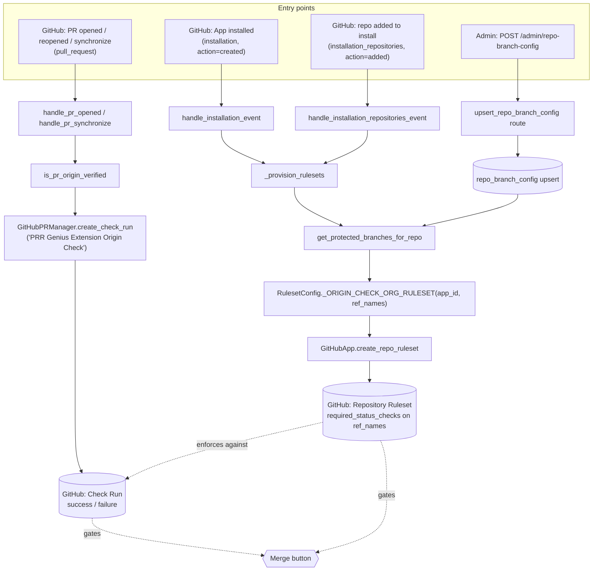
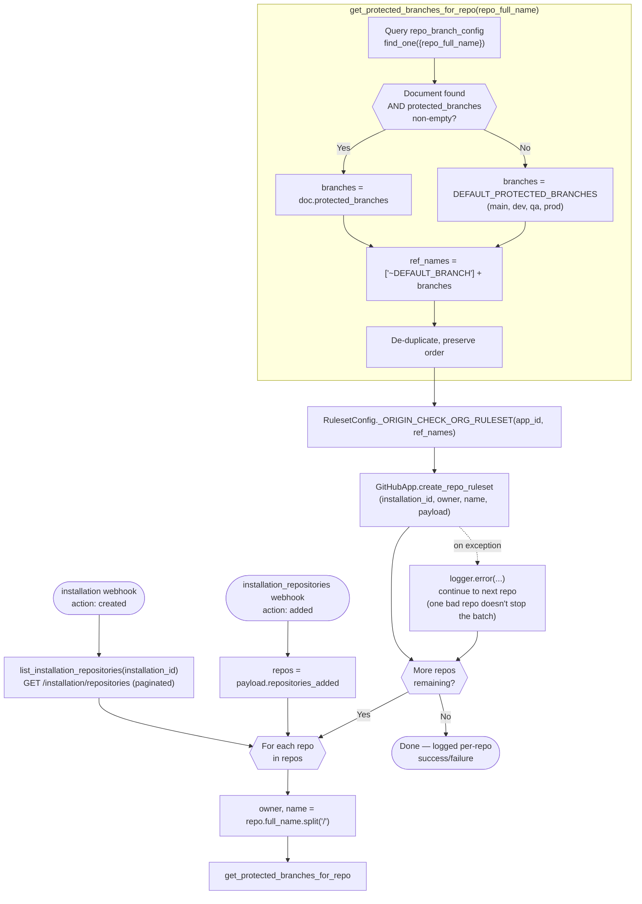
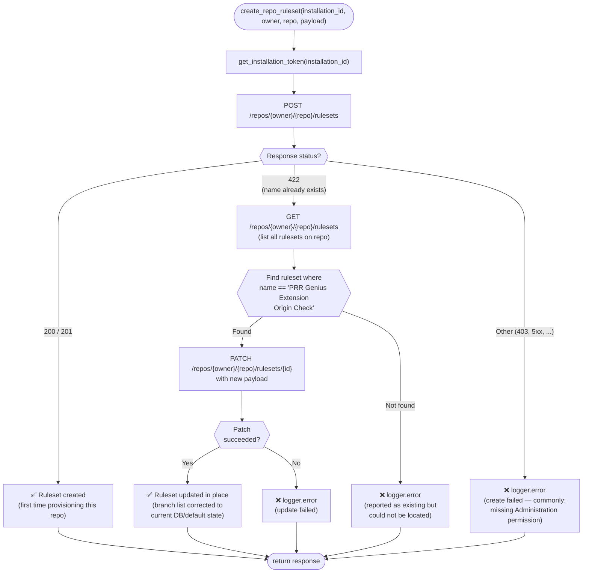
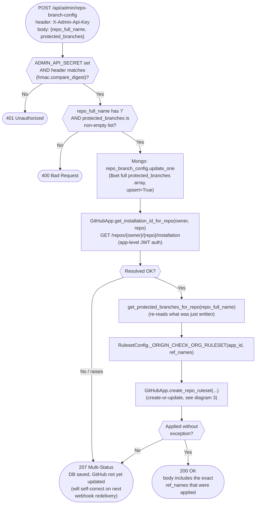
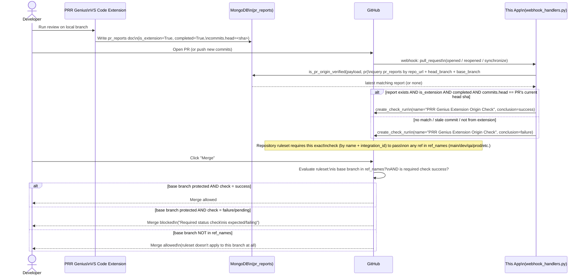

# Per-Repo Branch Protection Automation — Flow Charts

Companion to [`automation.md`](./automation.md), which has the full code changes and
explanations. This file is the visual reference — how the pieces connect and in what
order things fire, across all three entry points into the system:

1. GitHub webhooks (`installation`, `installation_repositories`, `pull_request`)
2. The admin API (`POST /admin/repo-branch-config`)
3. GitHub's own ruleset enforcement, once a repo is provisioned

---

## 1. System overview — all entry points

**How to read this:** the top row is every way this system gets triggered. Everything
on the left (`A1`, `A2`, `A3`) ends up building and applying a **ruleset** — the thing
that decides *which branches* require the check. Everything on the right (`A4`) decides
*whether the check passes* for a specific PR. GitHub combines both at merge time: the
ruleset says "this branch needs a passing `PRR Genius Extension Origin Check`," and the
check run says whether this PR's head commit has one.

---

## 2. Provisioning a ruleset — fresh install / new repo added

---

## 3. `create_repo_ruleset` — the self-healing create-or-update logic

---

## 4. Admin API request — `POST /admin/repo-branch-config`

---

## 5. PR lifecycle — origin check + merge gating (end-to-end sequence)

---

## 6. Where each diagram maps back to `automation.md`

| Diagram | Corresponds to section in `automation.md` |
|---|---|
| 1. System overview | Whole document, high level |
| 2. Provisioning flow | §1 (`enums.py`), §3 (`webhook_handlers.py`) |
| 3. Self-healing create/update | §2b (`auth.py` — `create_repo_ruleset`) |
| 4. Admin API flow | §2a (`auth.py` — `get_installation_id_for_repo`), §5 (`routes.py`) |
| 5. PR sequence | Pre-existing origin-check feature (`is_pr_origin_verified`, `create_check_run`) that this automation gates via the ruleset |

Edge cases and what's still uncovered are listed in `automation.md`'s
**"Edge case coverage"** table — this file only shows the happy-path flow through each
piece, not the failure/gap scenarios.
